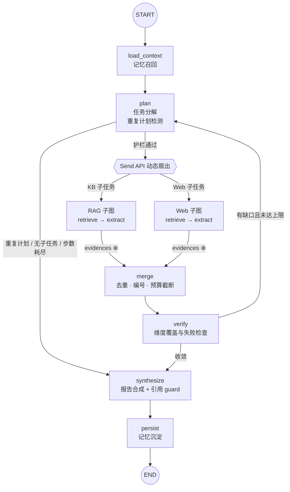

<div align="center">

# Evidence Deep Research

### Research with receipts.

**可溯源的多路并行研究系统。**

把技术选型问题拆成并行研究任务，让结论回到证据，让失败留下轨迹。

[](https://github.com/Anhao1314/evidence-deep-research/actions/workflows/ci.yml)
[](https://www.python.org/)
[](LICENSE)

`LangGraph` · `MCP` · `RAG` · `FastAPI` · `SQLite`

[快速开始](#快速开始) · [系统架构](#系统架构) · [真实演示](docs/demo.md) · [评测方法](docs/evaluation.md) · [录屏脚本](docs/demo-script.md) · [设计决策](#设计决策)

</div>

---

Evidence Deep Research 是一个面向**技术选型调研**的 Deep Research 后端。

用户提出问题后，LangGraph 主图完成任务分解，通过 `Send API` 并行调度知识库 RAG 与 Web 检索子 Agent，合并去重证据、检查信息缺口，最终生成研究报告。**可追溯的结论带 `[E#]` 证据编号与 `[S#]` 来源编号；无法追溯的模型结论会被 Guard 隔离，不留在主报告。**

> 目标不是生成一份看起来完整的报告，而是让每个结论都能回到证据，每次失败都留下轨迹。

**无需 API Key 即可端到端运行。**离线模式使用规则 Provider、自研 BM25 和内置演示语料；在线模式可切换任意 OpenAI 兼容模型与 Tavily 搜索。

## 3 分钟看懂

### 解决什么问题

技术选型问题（选 A 还是 B、某对象是否适合生产）很容易被写成“看起来完整”的报告，但结论无法回到证据。本项目把问题拆成对象×维度的子任务，并行检索知识库与 Web，证据统一去重编号；报告中的可追溯结论带证据编号，无法追溯的结论被隔离到 `unverified_claims`，失败与信息缺口进入同一条 Trace。用户约束（规模、团队、成本、部署、技术栈）会被抽取并做结构化核验，无法核验时明确写“无法判断”，不编造推荐。

### 核心架构

```text
研究问题
  → LangGraph 主图：plan（分解 / 重规划）→ Send API 并行扇出
  → RAG 子图（MCP stdio + BM25）   Web 子图（Demo / Tavily）
  → merge（去重 / 编号 / 预算）→ verify（维度缺口）→ synthesize（引用 guard）
  → persist（记忆）+ Trace（SQLite）
```

离线与在线只替换 LLM Provider 与 Search Provider，研究主图、子图与断言层不复制两套逻辑。

### 如何运行

```bash
python -m venv .venv && source .venv/bin/activate
python -m pip install -e ".[dev]"

pytest -q
python -m eval.run_eval --output docs/artifacts/eval-report.json
python -m eval.run_offline_suite --output docs/artifacts/offline-suite-report.json
```

以上全部离线运行，不需要 API Key。

### 已验证什么

- 135 个离线测试通过；既有 5 条行为回归 5/5（每条 11/11 断言）；20 条真实任务中 10 条 offline-eligible 结构回归 10/10（每条 13/13 断言）；输出见 [`docs/artifacts/`](docs/artifacts/)；
- 真实 MCP stdio 知识库链路、`Send` 并行扇出、22 条原始证据去重为 13 条、引用编号合法、来源带定位与内容哈希；
- **Citation Guard**：非法引用重写一次；重写改正文会被拒绝；仍不合法时结论被隔离，主报告只保留可追溯结论；极端情况下 fail-closed 回退模板/安全占位；
- **约束闭环**：离线合成 fixture 中，500 万向量、5 人、自托管、低成本、不引入新数据库的约束使 pgvector 成为唯一推荐，Atlas/Helios 被明确排除；证据不足时输出“无法判断”；
- **无关证据排除**：领域外问题检索到的文档全部标记为 `unscoped_question` 并排除，不进入报告或引用列表，信息缺口仍保留；
- **确定性 replan**：脚本化 fixture 触发首轮缺口 → verify → 第二轮补充检索 → 收敛，Trace 可证明两轮 plan 与第二轮检索词；
- 失败路径：故障注入触发重试/降级/缺口，报告仍产出但不伪造证据；
- 在线 Runner 的 `NOT_RUN` 防伪路径：缺 Key 时拒绝运行，不拿离线结果冒充在线结果。

### 尚未验证什么

- **在线真实评测未运行（NOT_RUN）**：当前环境没有模型/搜索 API Key，未调用任何外部 API，未生成在线成功率、延迟、Token 或成本；full 双路见 [`docs/artifacts/online/NOT_RUN.json`](docs/artifacts/online/NOT_RUN.json)，Web-only 见 [`docs/artifacts/online-web/NOT_RUN.json`](docs/artifacts/online-web/NOT_RUN.json)；
- **事实正确率与引用语义支撑率未测量**：Guard 与自动指标只处理结构、引用编号和来源完整性；语义部分只接受人工标注，未标注即 `NOT_MEASURED`；
- **在线 Badcase：NOT_RUN／未产生在线样本**（未运行，不能写成数量为 0）；
- 在线模型质量、真实搜索召回、在线 replan 质量、跨运行方差均未测量；
- 真实 KB 双路评测需要设置 `DR_KB_CORPUS_DIR`；未配置时只能运行显式 Web-only 子集，不能宣称完成原 20 条全量双路。

> 一句话：已验证“流程与引用可审计”，尚未验证“答案一定正确”。

## 三个核心承诺

### 01 · Parallel by design

主图负责规划与收敛，检索子图负责执行。`Send` 动态扇出 RAG／Web 子任务，子 Agent 只向 reducer 通道回写证据与失败信息，内部状态保持私有。

### 02 · Evidence before eloquence

证据在合成前统一去重、排序和编号。在线模型生成非法引用时，先做一次受限重写；**重写必须通过程序校验（去引用后正文不变），仍不合法则把结论移出主报告**，写入 `unverified_claims`，而不是删掉引用后继续展示结论。

### 03 · Failure is part of the trace

工具重试、路线降级、重复计划检测、轮数／步数护栏与信息缺口都进入同一条研究链路。失败不会被包装成成功，也不会让主图无休止重试。

## 能力地图

| 能力 | 实现 |
| --- | --- |
| 动态任务分解 | `app/graph/`：LangGraph 主图、条件边与 `Send API` 动态扇出 |
| 双路并行检索 | `app/agents/`：RAG／Web 检索子图，可独立 `invoke` 与测试 |
| 真实 MCP 工具链 | `mcp_server/`：stdio 子进程、持久会话、`kb_search`／`kb_get_doc` |
| 证据与引用 | `app/report/`：证据统一编号、来源解析、Guard 前原始输出/后最终报告/隔离结论 |
| 用户约束 | `app/constraints.py`：规模/团队/成本/部署/技术栈约束抽取与结构化核验 |
| 相关性门 | `app/graph/nodes.py` merge：区分检索到/实际采用/排除（含原因） |
| 确定性 replan | `tests/test_replan_deterministic.py` + fixture：两轮 plan 与补充检索可审计 |
| 失败恢复 | `app/guardrails/` + `ResilientProvider`：重试、降级、重复计划与预算护栏 |
| 跨会话记忆 | `app/memory/`：SQLite 三表保存偏好、历史主题与可复用结论 |
| 全链路 Trace | `app/trace/`：结构化事件、Token usage、报告跨进程回查 |
| 离线行为评测 | `eval/cases.jsonl` + `eval/assertions.py`：结构化断言、机器可读报告、CI 卡点 |
| 真实任务集 | `eval/tasks/`：20 条全量双路 + 9 条明确 Web-only 子集 |
| 在线评测 Runner | `eval/online_runner.py`：真实模型/搜索、full/web-only 模式、NOT_RUN 防伪 |
| 人工语义复核 | `eval/annotation.py`：run/report/template 绑定 + 分层抽样 + 校验后统计 |

## 系统架构



并行分支采用 map-reduce 汇合：子 Agent 只回写 `raw_evidences` 与 `route_failures` 两个 `operator.add` reducer 通道，避免并行实例争抢 `LastValue` 状态。

```text
FastAPI
   │
   ▼
ResearchRuntime
   ├── LangGraph 主图：plan → dispatch → merge → verify → synthesize
   ├── RAG 路：McpKBClient ──stdio──► 自研 MCP Server ──► BM25
   ├── Web 路：SearchProvider ──► Demo Search / Tavily
   ├── LLM 路：ResilientProvider ──► OpenAI Compatible / Heuristic
   └── 持久层：MemoryStore + TraceStore（SQLite）
```

评测代码与运行逻辑分离，共享同一套 `ResearchRuntime` 与断言：

```text
eval/
  cases.jsonl                 5 条离线行为回归（CI）
  tasks/research_tasks.v1.json 20 条真实任务（6 多对象 / 6 单对象 / 4 信息不足 / 4 缺口）
  assertions.py               自动断言（结构、引用、来源、路线、护栏）
  metrics.py                  指标纯函数（合法率、可回溯率、P50/P95、失败分类）
  run_offline_suite.py        10 条 offline-eligible 结构回归（CI）
  online_runner.py            在线 Runner（真实模型/搜索；缺 Key 写 NOT_RUN）
  annotation.py               引用语义人工标注模板与统计
```

## 快速开始

要求 **Python 3.11+**。以下流程默认离线运行，不访问真实模型或搜索服务。

```bash
git clone https://github.com/Anhao1314/evidence-deep-research.git
cd evidence-deep-research

python -m venv .venv
source .venv/bin/activate        # Windows PowerShell: .venv\Scripts\Activate.ps1
python -m pip install -e ".[dev]"

# 全量离线测试，包含真实 MCP stdio 链路
pytest -q

# 既有 5 条行为回归 + 10 条真实任务的结构回归
python -m eval.run_eval --output docs/artifacts/eval-report.json
python -m eval.run_offline_suite --output docs/artifacts/offline-suite-report.json

# 重新生成真实演示产物与 docs/demo.md
python scripts/capture_demo.py

# 启动服务
uvicorn app.api.main:app --port 8000
```

发起一次技术选型研究：

```bash
curl -s -X POST localhost:8000/api/research \
  -H "Content-Type: application/json" \
  -d '{
    "question": "RAG 系统的向量库选 Qdrant 还是 Milvus？",
    "user_id": "me"
  }'
```

响应包含报告、证据、来源与 `report_id`。使用本次返回的 ID 查询完整事件流：

```bash
curl -s localhost:8000/api/traces/run-xxxxxxxxxxxx
```

仓库附有一次真实离线运行的报告与 Trace；演示页由 `scripts/capture_demo.py` 从运行产物自动生成，不是手写效果稿：[查看演示](docs/demo.md)。

### 在线模式

```bash
cp .env.example .env
```

在 `.env` 中设置 `DR_MODE=online`，并配置真实模型与搜索：

```bash
DR_MODE=online
DR_LLM_BASE_URL=https://api.deepseek.com/v1
DR_LLM_API_KEY=<key>
DR_LLM_MODEL=deepseek-chat
DR_SEARCH_PROVIDER=tavily
DR_TAVILY_API_KEY=<key>

# 可选：成本核算，两者都填才会计算
DR_LLM_PRICE_INPUT_PER_1M=
DR_LLM_PRICE_OUTPUT_PER_1M=
```

运行在线评测（full 双路需要真实 KB）：

```bash
DR_KB_CORPUS_DIR=/path/to/real-corpus \
python -m eval.online_runner --mode full \
  --output-dir eval/runs/online-full-$(date +%Y%m%d-%H%M%S)
```

没有真实 KB 时，只能运行显式 Web-only 子集：

```bash
python -m eval.online_runner --mode web-only \
  --output-dir eval/runs/online-web-$(date +%Y%m%d-%H%M%S)
```

Runner 在 preflight 阶段检查 `DR_MODE`、模型 Key、真实搜索 Key 与 KB 模式。**full 模式如果仍指向内置演示 KB，会被拒绝**，不会静默把 both 改成 web。缺任何一项时只写 `NOT_RUN.json` 并退出，**不会**回落到启发式 Provider 后仍标记 online。`--mode web-only` 会关闭 KB 路，manifest 标记 `evaluation_scope=web_only_subset`，统计分母只覆盖 9 条 Web-only 用例，不能宣称完成原 20 条全量双路。

密钥只放在本地环境或 `.env`，不要提交到仓库；`run_manifest.json` 不记录 API Key。

### Docker Compose

```bash
docker compose up -d
curl -s localhost:8000/api/health
```

数据目录通过卷挂载，SQLite 记忆、报告与 Trace 可跨进程保留。

## 评测

评测分五层，**结构合法与语义正确严格分开**：

| 层 | 内容 | 需要 Key | 当前状态 |
| --- | --- | --- | --- |
| L1 离线测试 | `pytest`：图、护栏、MCP 真链路、Guard、约束、replan | 否 | PASS（[verification.log](docs/artifacts/verification.log)） |
| L2 离线行为回归 | 5 条确定性用例 | 否 | 5/5（[eval-report.json](docs/artifacts/eval-report.json)） |
| L3 离线任务集结构回归 | 20 条中 10 条 `offline_eligible` | 否 | 10/10（[offline-suite-report.json](docs/artifacts/offline-suite-report.json)） |
| L3b 约束 fixture | 3 条合成约束场景 | 否 | 3/3（[constraint-fixture-report.json](docs/artifacts/constraint-fixture-report.json)） |
| L4 在线真实评测 | full 双路 / web-only 子集 | 是 | **NOT_RUN**（[NOT_RUN.json](docs/artifacts/online/NOT_RUN.json)） |
| L5 引用语义复核 | 人工标注 `supported/partial/unsupported/cannot_judge` | 否 | **NOT_MEASURED** |

### 任务集

[`eval/tasks/research_tasks.v1.json`](eval/tasks/research_tasks.v1.json) 共 20 条：多对象选型 6、单对象研究 6、信息不足/领域外 4、需要重规划或存在检索缺口 4。10 条 `offline_eligible=true` 进入 CI，另外 10 条只有在线运行后才能评价。

另有显式 [`research_tasks.v1.web-only.json`](eval/tasks/research_tasks.v1.web-only.json)（9 条，`route_mode=web_only`）：没有真实 KB 时只能运行这个子集，KB 路显式关闭，统计分母只覆盖该子集；它**不是**原 20 条全量双路评测。

### 自动指标

- `pipeline_completion_rate`（流程完成率）、`all_checks_pass_rate`（全部自动检查通过率，不等于事实正确率）；
- `pre_guard_citation_valid_rate`（原始模型输出引用合法率）与 `post_guard_citation_integrity_rate`（最终报告引用完整率）；
- `guard_rewrite_rate`、`guard_claim_quarantine_rate`、`guard_fallback_rate`（均带分子/分母）；
- `source_reference_integrity_rate` 与 `source_resolution`（定位、内容哈希、来源/证据解析；URL 可访问性单独标 `NOT_MEASURED`）；
- `citation_coverage` 只统计结论区域，排除证据明细/参考来源；
- 路线覆盖率、维度覆盖率、P50/P95 延迟、Token、可配置成本、失败类型分布。

旧名 `task_completion_rate`、`citation_id_validity_rate`、`source_traceability_rate` 不再出现在新产物中。定义、公式与分母见 [评测方法](docs/evaluation.md)。

### 人工指标

引用语义支撑只接受人工标注：`supported` / `partial` / `unsupported` / `cannot_judge`。不使用 LLM Judge 的分数冒充人工事实正确率；未标注时报告显示 `NOT_MEASURED`，而不是 0。

模板绑定 `run_id`、`report_sha256`、`template_sha256` 与 `claim_id`，按 section/object 分层抽样并记录 seed。`summarize` 会拒绝未知 claim、跨 run、冲突标签和模板/报告哈希不匹配：

```bash
# 保留原始模板用于哈希校验，复制一份填写
cp <run_dir>/annotation_template.csv labels.csv
# 填写 label / rationale / annotator / annotated_at 后：
python -m eval.annotation summarize \
  --labels labels.csv --template <run_dir>/annotation_template.csv \
  --run-dir <run_dir> --output human-metrics.json
```

### 命令

```bash
pytest -q
python -m eval.run_eval --output docs/artifacts/eval-report.json
python -m eval.run_offline_suite --output docs/artifacts/offline-suite-report.json
python -m eval.run_constraint_fixture --output docs/artifacts/constraint-fixture-report.json

# 在线 full 双路：需要真实模型/搜索 Key 与真实 DR_KB_CORPUS_DIR
DR_MODE=online DR_LLM_API_KEY=... DR_SEARCH_PROVIDER=tavily DR_TAVILY_API_KEY=... \
DR_KB_CORPUS_DIR=/path/to/real-corpus \
python -m eval.online_runner --mode full \
  --output-dir eval/runs/online-full-$(date +%Y%m%d-%H%M%S)

# 没有真实 KB 时：只允许显式 Web-only 子集，KB 关闭
DR_MODE=online DR_LLM_API_KEY=... DR_SEARCH_PROVIDER=tavily DR_TAVILY_API_KEY=... \
python -m eval.online_runner --mode web-only \
  --output-dir eval/runs/online-web-$(date +%Y%m%d-%H%M%S)
```

`pytest` 与离线 Runner 消费同一套断言；不达标时非零退出，CI 同步失败。CI 不依赖外部 API。在线 full 模式在演示 KB 上会被 preflight 拒绝，不会静默把 both 改成 web。

## 设计决策

| 决策 | 取舍 | 记录 |
| --- | --- | --- |
| Send API 子图，而非独立 Agent 进程 | 在同进程内完成并行扇出与 reducer 合并；进程边界只留给真正需要独立生命周期的 MCP | [ADR-001](docs/adr/ADR-001-subagent-send-subgraph.md) |
| 真实 stdio MCP，而非进程内函数 | 用协议边界证明知识库可替换，同时避免额外 HTTP 端口 | [ADR-002](docs/adr/ADR-002-mcp-knowledge-base.md) |
| 小规模语料使用 BM25 | 数百条语料下保持低部署成本与确定性；语义检索通过协议扩展 | [ADR-003](docs/adr/ADR-003-bm25-retriever.md) |
| 只沉淀可复用记忆 | 保存偏好、主题与有证据的结论，不无限堆积原始对话 | [ADR-004](docs/adr/ADR-004-memory-schema.md) |
| 引用 Guard fail-closed | 非法引用先重写；重写必须通过正文一致性校验；仍非法则隔离结论，极端情况回退模板/安全占位 | [ADR-005](docs/adr/ADR-005-citation-guard.md) |
| 三层防死循环护栏 | 步数、轮数与重复计划指纹共享同一套纯函数判定 | [ADR-006](docs/adr/ADR-006-failure-recovery.md) |

## API

| 方法 | 路径 | 用途 |
| --- | --- | --- |
| `POST` | `/api/research` | 创建一次同步研究 |
| `GET` | `/api/reports/{id}` | 读取持久化报告 |
| `GET` | `/api/traces/{id}` | 读取完整事件流与 Token 汇总 |
| `GET` | `/api/memory/{user_id}` | 查看用户偏好与历史主题 |
| `POST` | `/api/preferences` | 写入跨会话偏好 |
| `GET` | `/api/health` | 查看运行模式与知识库后端 |

## 项目结构

```text
app/
  api/          FastAPI 与 Runtime 生命周期
  graph/        主图、状态、节点、派发与组合根
  agents/       RAG／Web 检索子图与公共骨架
  constraints.py 用户约束抽取与结构化核验
  llm/          Heuristic／OpenAI Compatible／Resilient Provider
  mcp_client/   stdio 子进程与持久会话桥接
  memory/       跨会话偏好、主题与结论记忆
  report/       报告合成、来源收集与 fail-closed 引用 Guard
  schema/       Evidence／Report／Plan／Guard／Constraint 模型
  tools/        KBClient／SearchProvider 协议与实现
  guardrails/   步数、轮数与重复计划护栏
  trace/        结构化事件与报告持久化
knowledge_base/ 自研 BM25、分词与检索协议
mcp_server/     知识库 MCP Server
data/
  corpus/       离线演示语料
  fixtures/     约束 fixture 与 Web-only 合成数据
eval/
  cases.jsonl                 5 条离线行为回归（CI）
  tasks/                      20 条全量双路 + 9 条 Web-only 子集
  fixtures/                   相关性标签、约束任务
  assertions.py               自动断言
  metrics.py                  pre/post Guard、来源、延迟、失败分类
  run_offline_suite.py        离线结构回归（CI）
  run_constraint_fixture.py   约束 fixture（CI）
  online_runner.py            在线 Runner（full / web-only / NOT_RUN）
  annotation.py               运行绑定 + 分层抽样 + 人工指标
  provenance.py               源码树指纹与语料清单
scripts/        真实运行捕获与 demo 生成
docs/adr/       架构决策记录
docs/artifacts/ 真实运行产物（评测报告、Trace、NOT_RUN）
tests/          离线单元、集成、Guard、约束、replan 与 MCP 真链路测试
```

## 诚实的边界

- **在线评测尚未运行。**当前环境没有真实模型/搜索 Key；仓库中的在线状态是 `NOT_RUN`，没有在线成功率、延迟、Token 或成本数字。
- **离线语料是演示快照。**内置文本用于可复现测试，不代表最新事实；生产使用应接入真实知识库与在线搜索。
- **默认演示语料缺少结构化约束属性**，因此真实问题里的约束会被标记为“无法核验”；约束真正影响结论只在合成 fixture 中验证（见 [演示](docs/demo.md)）。这些名称仅作为合成 fixture 中的评测对象，结构化属性为测试构造，不代表同名真实产品的真实能力，也不构成真实技术选型建议。
- **相关性门只是保守范围门。**当前范围门对无可核实对象的泛化问题采取保守排除策略，只解决演示语料误入报告的问题，不等于通用开放域相关性判断。
- **自动指标不验证语义。**`pipeline_completion_rate`、`post_guard_citation_integrity_rate`、`source_reference_integrity_rate` 等都不证明结论为真，也不证明引用在语义上支撑结论。
- **Guard 只保证非法编号不继续作为有效引用展示。**它会把无法追溯的结论移出主报告，因此报告可能变短或回退到模板；它不能替代事实核查与人工语义复核。
- **在线 full 双路评测需要真实 KB。**未设置 `DR_KB_CORPUS_DIR` 时只能运行显式 Web-only 子集，KB 路关闭；不能把该子集冒充原 20 条全量双路。
- **研究接口当前为同步调用。**长时间在线研究应改为异步任务与轮询；SQLite 面向单机与中小规模。
- **本次修复未提交。**产物记录 `source_tree_fingerprint`、tracked diff SHA256 与未跟踪源码文件哈希，便于在未 commit 的工作区上复核。

## 借鉴与实现边界

研究主循环参考了 LangChain `deep agents` 的规划－执行分离思路与 `deepsearch-agents` 的检索－交叉核对范式；工程原则参考 Anthropic《Building Effective Agents》。

本仓库的图结构、状态设计、护栏、Trace、MCP 知识库与评测断言均为独立实现。详细取舍见 [ADR 文档](docs/adr/)。

---

<div align="center">

**Every claim should leave a trail.**

[MIT License](LICENSE)

</div>
