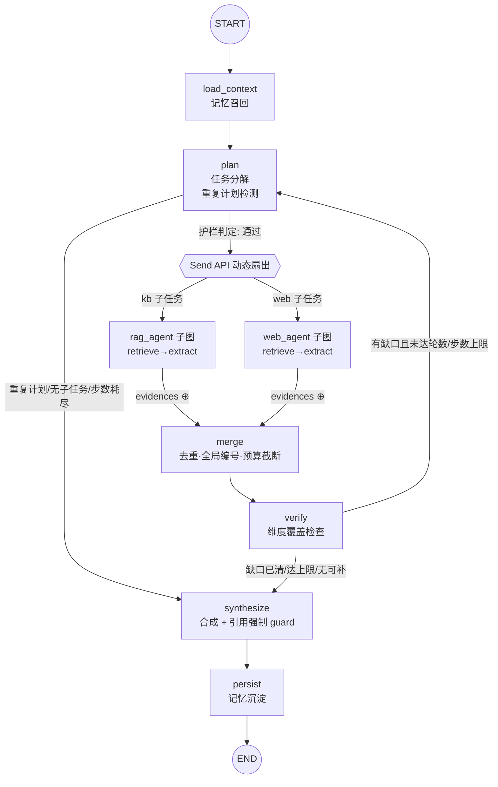

# Deep Research · 技术选型调研多智能体研究系统

[](./actions)

用户提出一个技术选型问题 → 主 Agent（LangGraph）分解任务 → 调度多个子 Agent **并行检索**（网络搜索 + 知识库 RAG 两条路）→ 交叉核对 → 产出一份**每个结论都带可回溯引用**的研究报告。

垂直领域为**技术选型调研**（向量数据库 / Agent 编排框架 / 大模型 API）。**不配置任何 API Key 也能端到端跑通**（启发式规则模式 + 内置演示语料），线上模式切换 DeepSeek / 通义 / OpenAI 任意 OpenAI 兼容 API。

核心工程能力点：LangGraph 图编排（Send API 动态并行）· 自研 MCP Server · 跨会话记忆 · 全链路结构化 Trace · 引用强制溯源 · 失败恢复与防死循环 · 离线可测的评测钩子。

---

## 架构

```
用户问题
   │
   ▼
FastAPI（POST /api/research · GET /api/reports/{id} · GET /api/traces/{id} · GET /api/memory/{user_id}）
   │
   ▼
┌───────────────────────────────────────────────────────────┐
│ LangGraph 主图（Planner / Orchestrator）                    │
│                                                           │
│ load_context ──► plan ──[条件边+Send 动态扇出]──► merge ──► verify
│  ▲ 记忆召回        │分解      │              │去重编号   │交叉核对
│  │                │       ┌──┴───┐          │          ├─有缺口─► replan（轮数上限内）
│  │           [重复计划检测] rag子图  web子图     │          ▼
│  │                │       └──┬───┘          └────► synthesize（合成+引用 guard）
│  │                ▼          │                                 │
│  │        [步数/轮数护栏]       │                                 ▼
│  └──────────────────── persist ◄─────────────────────────────┘
│                        记忆沉淀 → END                        │
└───────────────────────────────────────────────────────────┘
      │ 知识库路：真实 MCP stdio 子进程      │ LLM 抽象层（可插拔）
      ▼                                  ▼
┌────────────────────┐          ┌──────────────────────────┐
│ 自研 MCP Server     │          │ ResilientProvider         │
│ kb_search /        │          │  ├─ OpenAICompat（在线）   │
│ kb_get_doc         │          │  │   DeepSeek/通义/OpenAI  │
│ (自研 BM25+SQLite)  │          │  ├─ 引用 guard：重写/剥离  │
└────────────────────┘          │  └─ 失败降级 → Heuristic   │
                                 └──────────────────────────┘
```

## LangGraph 状态图



并行分支的汇合点是 map-reduce：子 Agent 实例只向 `raw_evidences`（`Annotated[list, operator.add]`）与 `route_failures` 两个 reducer 通道回写，其余内部状态完全私有（见 [ADR-001](docs/adr/ADR-001-subagent-send-subgraph.md)）。

## 快速开始（无 Key 可跑）

```bash
git clone https://github.com/Anhao1314/-Deep-Research-.git deep-research
cd deep-research
python -m venv .venv && source .venv/Scripts/activate   # Windows Git Bash；Linux: source .venv/bin/activate
pip install -e ".[dev]"

# 1) 全量测试（零网络、零模型调用，含 MCP 真链路）
pytest -q

# 2) 起服务（离线模式）
uvicorn app.api.main:app --port 8000

# 3) 发起一次研究
curl -s -X POST localhost:8000/api/research \
  -H "Content-Type: application/json" \
  -d '{"question": "RAG 系统的向量库选 Qdrant 还是 Milvus？", "user_id": "me"}' | jq .summary

# 4) 查全链路 trace（事件流 + token 汇总）
curl -s localhost:8000/api/traces/run-xxxxxxxxxxxx | jq '.events[].event_type'

# 5) 跨会话记忆：设置偏好后，后续报告语言随之切换
curl -s -X POST localhost:8000/api/preferences -H "Content-Type: application/json" \
  -d '{"user_id": "me", "key": "report_language", "value": "en"}'
```

评测（不达标 exit 1，CI 卡点）：

```bash
python -m eval.run_eval --output eval-report.json   # 5 用例 × 9 类行为断言
```

Docker Compose（数据目录卷挂载，SQLite 持久化到宿主机）：

```bash
docker compose up -d
curl -s localhost:8000/api/health   # {"status": "ok", "mode": "offline", "kb_backend": "McpKBClient"}
```

### 在线模式

复制 `.env.example` 为 `.env`，改 `DR_MODE=online` 并填 Key。模型侧兼容任意 OpenAI 协议（DeepSeek / 通义百炼 / OpenAI），搜索侧实现 `SearchProvider` 协议即可接入（内置 Tavily）。在线模式的 LLM 故障会**自动降级**到规则模式（降级事件落 trace），研究流程不会中断。

## 功能清单

| 能力 | 实现 |
|---|---|
| 主 Agent 任务分解/调度/合并 | `app/graph/`：LangGraph 主图 + Send API 条件边动态扇出 |
| 双子 Agent 并行、独立可测 | `app/agents/`：retrieve→extract 子图，可单独 `invoke` |
| 自研 MCP Server | `mcp_server/`：mcp 2.x SDK，stdio 子进程，`kb_search`/`kb_get_doc` |
| 跨会话记忆 | `app/memory/`：SQLite 三表（偏好/历史主题/结论沉淀），召回在 `load_context`、沉淀在 `persist` |
| 全链路 Trace | `app/trace/`：13 类结构化事件 + `GET /api/traces/{id}` |
| 报告带真实引用 | `app/report/`：证据统一编号，[E#] 与来源一一对应 + guard 硬校验 |
| 失败恢复与防死循环 | `app/guardrails/` + `ResilientProvider`：重试/降级/轮数/步数/重复计划指纹 |
| 离线可跑 | `HeuristicProvider` + 自研 BM25 + 内置演示语料，pytest 全程不触网 |
| 评测钩子 | `eval/`：结构化断言接口，pytest 与外部评测框架共用 |

## 设计取舍（为什么这么选）

**子 Agent 用 Send API 子图，而不是独立进程。** 子 Agent 的开销主要在检索与 LLM，进程隔离带来的只有序列化成本和状态同步负担。LangGraph 的 Send（map-reduce）在同进程内并行扇出、reducer 原生合并，且子图可以单独 invoke 测试。进程边界只留给知识库——那里才需要独立生命周期（MCP 子进程）。代价：LangGraph 1.x 中 Send 必须从条件边返回、子图必须包装节点只回写 reducer 通道，这两个适配点都封装在 `make_dispatch_router` 与 `as_graph_node`。

**知识库检索做成真实 stdio MCP Server，不用进程内函数。** 这是工具系统可替换性的证明：`KBClient` 协议下 `InProcessKBClient` 与 `McpKBClient` 可互换，主图与子 Agent 零改动。选 stdio 而非 HTTP：单机部署零端口暴露、生命周期与主进程绑定、MCP handshake 后持久会话复用（见 [ADR-002](docs/adr/ADR-002-mcp-knowledge-base.md)）。

**检索自研 BM25（纯 Python），pgvector 留作扩展位。** 语料在数百条量级时，BM25 内存倒排毫秒级返回，且离线模式零依赖、测试确定性可复现。引入向量库是部署成本而非能力收益。`Retriever` 协议（`knowledge_base/retriever.py`）是唯一检索抽象，语义检索实现同一协议即可替换（见 [ADR-003](docs/adr/ADR-003-bm25-retriever.md)）。

**记忆只进结构化、可再利用的信息。** 短期记忆 = LangGraph State（run 生命周期），长期记忆 = SQLite 三表：偏好全量注入、历史主题与结论按 BM25 召回。不存原始对话——无法再利用的上下文是负债。偏好必须真实生效（`report_language` 切换报告语言、`max_evidences_per_object` 收紧预算），否则记忆就是摆设（见 [ADR-004](docs/adr/ADR-004-memory-schema.md)）。

**引用强制靠后处理 guard，不靠提示词自觉。** 离线模式下结论句直接由证据条目构造，引用在结构上不可能编造；在线模式下 LLM 输出经 guard：非法 [E#] → 受限重写一次 → 仍非法则剥离并落 error 事件。宁可无引用，不可假引用（见 [ADR-005](docs/adr/ADR-005-citation-guard.md)）。

**防死循环是三层纯函数护栏 + 一条降级链。** 全局步数上限、plan 轮数上限、重复计划指纹（signature 哈希）；失败链路：工具重试（指数退避）→ route_failures 降级不阻塞主图 → verify 把失败转为"信息缺口"显式写进报告 → LLM 故障由 ResilientProvider 降级到规则模式。所有判定在 `Guardrails` 中是纯函数，节点与条件边共享（见 [ADR-006](docs/adr/ADR-006-failure-recovery.md)）。

**Token 成本控制。** 每步 usage 落 trace（`usage` 事件按 stage/model 记账）；证据在 merge 阶段去重压缩（22 条原始证据 → 13 条进合成）；evidence 预算与偏好截断上限；离线模式 0 token。

## 借鉴点

- 任务分解 → 并行检索 → 汇总引用的研究主循环，参考了 LangChain **deep agents** 的规划-执行分离思路与 didilili/**deepsearch-agents** 的"检索-交叉核对"两段式；图结构、状态设计、护栏、Trace、评测断言均为本仓库原创实现。
- "能用简单编排就不要框架复杂度、编排封装在可替换接口后"的原则来自 Anthropic《Building Effective Agents》，本仓库以 `KBClient`/`SearchProvider`/`LLMProvider` 三个协议落实。

## 评测

`eval/cases.jsonl` 5 用例（三个主题的对比研究、单对象研究、领域外降级），9 类断言全部基于结构化产物：检索路覆盖、证据数量、**引用无编造**、引用覆盖率、来源可回溯（含定位）、对象出现、计划轮数/步数上限、trace 关键事件完整性。`python -m eval.run_eval` 输出机器可读 JSON；`tests/test_eval.py` 消费同一断言模块——评测不达标即 CI 红。外部评测框架接入点：`eval.assertions.run_case`。

## 项目结构

```
app/
  api/          FastAPI（research/reports/traces/memory/preferences）
  graph/        主图（状态、节点、派发 router、组装工厂、ResearchRuntime）
  agents/       双子 Agent 子图 + 公共骨架（重试/降级/trace）
  llm/          Provider 抽象（Heuristic / OpenAICompat / Resilient）
  mcp_client/   MCP 客户端（stdio 子进程 + 持久会话线程桥接）
  memory/       跨会话记忆（SQLite 三表）
  trace/        全链路 Trace（events + reports 同库）
  report/       模板合成 + 引用 guard
  tools/        KBClient / SearchProvider 协议与实现
  guardrails/   步数/轮数/重复计划检测
  schema/       领域模型（Source/Evidence/Plan/Report）
knowledge_base/ 自研 BM25 + 分词 + 检索器协议
mcp_server/     自研知识库 MCP Server（stdio）
data/           内置演示语料（corpus/ web_demo/）+ 运行期 SQLite
eval/           评测集 + 断言接口 + runner
docs/adr/       架构决策记录（一决策一文档）
```

## 已知限制

- **演示语料是快照**：`data/` 内置语料基于公开资料整理（URL 指向真实站点但文本为演示摘录），离线模式的结论不代表最新事实；生产使用请替换为真实知识库与在线搜索。
- **离线 Planner 的领域边界**：规则分解依赖领域注册表（语料元数据自动构建），领域外问题走泛化降级（检索原问题关键词），产出质量明确下降——这是规则模式的诚实边界，在线模式由 LLM 规划补齐。
- **报告合成（离线）是模板化的**：结构完整、引用严格，但措辞与综合推断弱于在线 LLM 模式；在线模式的引用 guard 覆盖编造引用，但不校验"引用是否真的支撑该句"（那是评测框架里 LLM-as-judge 的职责）。
- **研究是同步接口**：`POST /api/research` 阻塞至完成（离线毫秒级）；长任务在线模式建议改异步 job + 轮询（trace/reports 持久化已就绪，改造成本低）。
- **单进程记忆**：SQLite 适合单机演示与中小规模；多实例部署需换 Postgres（pgvector 一并解决语义检索扩展）。
- **`evidence.aspect` 依赖语料标注**：在线搜索结果无维度标注时标记为 general，维度覆盖检查会倾向触发一轮 replan 补检索。

## License

[MIT](LICENSE)
