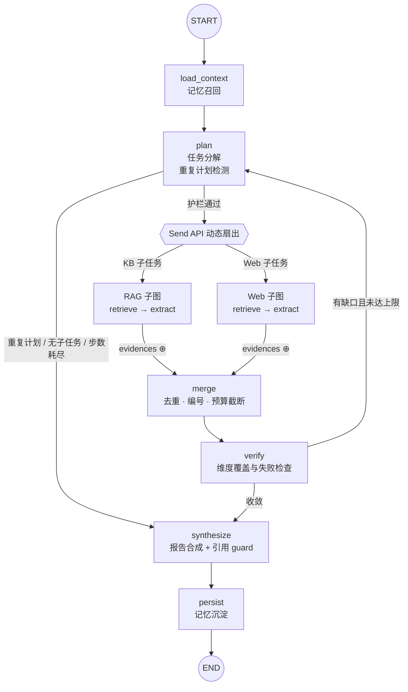

<div align="center">

# Evidence Deep Research

### Research with receipts.

**可溯源的多路并行研究系统。**

把技术选型问题拆成并行研究任务，让结论回到证据，让失败留下轨迹。

[](https://github.com/Anhao1314/evidence-deep-research/actions/workflows/ci.yml)
[](https://www.python.org/)
[](LICENSE)

`LangGraph` · `MCP` · `RAG` · `FastAPI` · `SQLite`

[快速开始](#快速开始) · [系统架构](#系统架构) · [真实演示](docs/demo.md) · [设计决策](#设计决策) · [评测](#评测)

</div>

---

Evidence Deep Research 是一个面向**技术选型调研**的 Deep Research 后端。

用户提出问题后，LangGraph 主图完成任务分解，通过 `Send API` 并行调度知识库 RAG 与 Web 检索子 Agent，合并去重证据、检查信息缺口，最终生成带有 `[E#]` 证据编号、`[S#]` 来源编号和完整 Trace 的研究报告。

> 目标不是生成一份看起来完整的报告，而是让每个结论都能回到证据，每次失败都留下轨迹。

**无需 API Key 即可端到端运行。**离线模式使用规则 Provider、自研 BM25 和内置演示语料；在线模式可切换任意 OpenAI 兼容模型与 Tavily 搜索。

## 三个核心承诺

### 01 · Parallel by design

主图负责规划与收敛，检索子图负责执行。`Send` 动态扇出 RAG／Web 子任务，子 Agent 只向 reducer 通道回写证据与失败信息，内部状态保持私有。

### 02 · Evidence before eloquence

证据在合成前统一去重、排序和编号。在线模型生成非法引用时，先受限重写一次；仍不合法则剥离并记录事件——**宁可没有引用，也不伪造引用。**

### 03 · Failure is part of the trace

工具重试、路线降级、重复计划检测、轮数／步数护栏与信息缺口都进入同一条研究链路。失败不会被包装成成功，也不会让主图无休止重试。

## 能力地图

| 能力 | 实现 |
| --- | --- |
| 动态任务分解 | `app/graph/`：LangGraph 主图、条件边与 `Send API` 动态扇出 |
| 双路并行检索 | `app/agents/`：RAG／Web 检索子图，可独立 `invoke` 与测试 |
| 真实 MCP 工具链 | `mcp_server/`：stdio 子进程、持久会话、`kb_search`／`kb_get_doc` |
| 证据与引用 | `app/report/`：证据统一编号、来源回溯、引用 guard |
| 失败恢复 | `app/guardrails/` + `ResilientProvider`：重试、降级、重复计划与预算护栏 |
| 跨会话记忆 | `app/memory/`：SQLite 三表保存偏好、历史主题与可复用结论 |
| 全链路 Trace | `app/trace/`：结构化事件、Token usage、报告跨进程回查 |
| 离线评测 | `eval/`：结构化断言、机器可读报告、CI 卡点 |

## 系统架构



并行分支采用 map-reduce 汇合：子 Agent 只回写 `raw_evidences` 与 `route_failures` 两个 `operator.add` reducer 通道，避免并行实例争抢 `LastValue` 状态。

```text
FastAPI
   │
   ▼
ResearchRuntime
   ├── LangGraph 主图：plan → dispatch → merge → verify → synthesize
   ├── RAG 路：McpKBClient ──stdio──► 自研 MCP Server ──► BM25
   ├── Web 路：SearchProvider ──► Demo Search / Tavily
   ├── LLM 路：ResilientProvider ──► OpenAI Compatible / Heuristic
   └── 持久层：MemoryStore + TraceStore（SQLite）
```

## 快速开始

要求 **Python 3.11+**。以下流程默认离线运行，不访问真实模型或搜索服务。

```bash
git clone https://github.com/Anhao1314/evidence-deep-research.git
cd evidence-deep-research

python -m venv .venv
source .venv/bin/activate        # Windows PowerShell: .venv\Scripts\Activate.ps1
python -m pip install -e ".[dev]"

# 全量离线测试，包含真实 MCP stdio 链路
pytest -q

# 启动服务
uvicorn app.api.main:app --port 8000
```

发起一次技术选型研究：

```bash
curl -s -X POST localhost:8000/api/research \
  -H "Content-Type: application/json" \
  -d '{
    "question": "RAG 系统的向量库选 Qdrant 还是 Milvus？",
    "user_id": "me"
  }'
```

响应包含报告、证据、来源与 `report_id`。使用本次返回的 ID 查询完整事件流：

```bash
curl -s localhost:8000/api/traces/run-xxxxxxxxxxxx
```

仓库附有一次真实离线运行的报告与 Trace，不是手写效果稿：[查看演示](docs/demo.md)。

### 在线模式

```bash
cp .env.example .env
```

在 `.env` 中设置 `DR_MODE=online`，配置模型与搜索服务：

- 模型：任意 OpenAI 兼容 API，内置 DeepSeek／通义／OpenAI 接入方式；
- 搜索：实现 `SearchProvider` 协议即可替换，内置 Tavily；
- 降级：在线 LLM 失败时回落到规则 Provider，降级原因写入 Trace。

密钥只放在本地环境或 `.env`，不要提交到仓库。

### Docker Compose

```bash
docker compose up -d
curl -s localhost:8000/api/health
```

数据目录通过卷挂载，SQLite 记忆、报告与 Trace 可跨进程保留。

## 评测

```bash
python -m eval.run_eval --output eval-report.json
```

当前评测集包含 **5 个行为用例**：三组技术选型对比、单对象研究与领域外降级。断言覆盖九类检查：

- 必须收敛并产出报告；
- RAG／Web 检索路覆盖；
- 证据数量下限；
- 引用编号无编造；
- 引用覆盖率；
- 来源可定位、可回溯；
- 研究对象出现；
- 计划轮数与步数护栏；
- Trace 关键事件完整性。

`pytest` 与外部评测 Runner 消费同一套 `eval.assertions`，评测不达标时进程以非零状态退出，CI 同步失败。

这些断言验证的是**结构、行为与引用合法性**，不等同于在线事实正确率或引用对结论的语义支撑率。

## 设计决策

| 决策 | 取舍 | 记录 |
| --- | --- | --- |
| Send API 子图，而非独立 Agent 进程 | 在同进程内完成并行扇出与 reducer 合并；进程边界只留给真正需要独立生命周期的 MCP | [ADR-001](docs/adr/ADR-001-subagent-send-subgraph.md) |
| 真实 stdio MCP，而非进程内函数 | 用协议边界证明知识库可替换，同时避免额外 HTTP 端口 | [ADR-002](docs/adr/ADR-002-mcp-knowledge-base.md) |
| 小规模语料使用 BM25 | 数百条语料下保持低部署成本与确定性；语义检索通过协议扩展 | [ADR-003](docs/adr/ADR-003-bm25-retriever.md) |
| 只沉淀可复用记忆 | 保存偏好、主题与有证据的结论，不无限堆积原始对话 | [ADR-004](docs/adr/ADR-004-memory-schema.md) |
| 引用 guard 后处理 | 不依赖提示词自觉；非法引用先重写，再剥离 | [ADR-005](docs/adr/ADR-005-citation-guard.md) |
| 三层防死循环护栏 | 步数、轮数与重复计划指纹共享同一套纯函数判定 | [ADR-006](docs/adr/ADR-006-failure-recovery.md) |

## API

| 方法 | 路径 | 用途 |
| --- | --- | --- |
| `POST` | `/api/research` | 创建一次同步研究 |
| `GET` | `/api/reports/{id}` | 读取持久化报告 |
| `GET` | `/api/traces/{id}` | 读取完整事件流与 Token 汇总 |
| `GET` | `/api/memory/{user_id}` | 查看用户偏好与历史主题 |
| `POST` | `/api/preferences` | 写入跨会话偏好 |
| `GET` | `/api/health` | 查看运行模式与知识库后端 |

## 项目结构

```text
app/
  api/          FastAPI 与 Runtime 生命周期
  graph/        主图、状态、节点、派发与组合根
  agents/       RAG／Web 检索子图与公共骨架
  llm/          Heuristic／OpenAI Compatible／Resilient Provider
  mcp_client/   stdio 子进程与持久会话桥接
  memory/       跨会话偏好、主题与结论记忆
  report/       报告合成、来源收集与引用 guard
  tools/        KBClient／SearchProvider 协议与实现
  guardrails/   步数、轮数与重复计划护栏
  trace/        结构化事件与报告持久化
knowledge_base/ 自研 BM25、分词与检索协议
mcp_server/     知识库 MCP Server
data/           离线演示语料与运行期 SQLite
eval/           评测集、断言接口与 Runner
docs/adr/       架构决策记录
tests/          离线单元、集成与 MCP 真链路测试
```

## 诚实的边界

- **这是双路检索子 Agent 系统，不是通用自主多 Agent 集群。**规划与报告合成由主流程统一协调。
- **离线语料是演示快照。**内置文本用于可复现测试，不代表最新事实；生产使用应接入真实知识库与在线搜索。
- **离线报告采用模板合成。**结构完整、引用确定，但综合推断能力弱于在线模型。
- **引用 guard 不验证语义支撑。**它能阻止不存在的证据编号，不能证明某条证据足以支持对应结论。
- **研究接口当前为同步调用。**长时间在线研究应改为异步任务与轮询。
- **SQLite 面向单机与中小规模。**多实例部署需要替换共享存储与检索基础设施。

## 借鉴与实现边界

研究主循环参考了 LangChain `deep agents` 的规划－执行分离思路与 `deepsearch-agents` 的检索－交叉核对范式；工程原则参考 Anthropic《Building Effective Agents》。

本仓库的图结构、状态设计、护栏、Trace、MCP 知识库与评测断言均为独立实现。详细取舍见 [ADR 文档](docs/adr/)。

---

<div align="center">

**Every claim should leave a trail.**

[MIT License](LICENSE)

</div>
